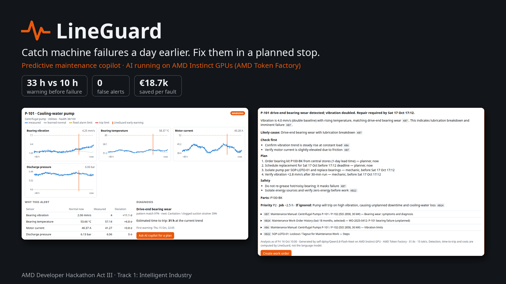
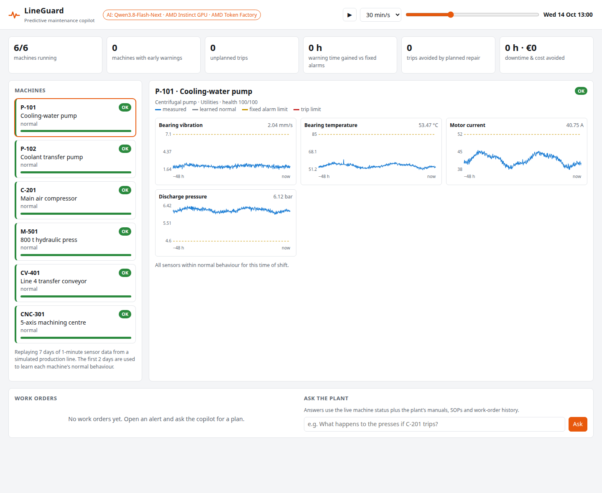
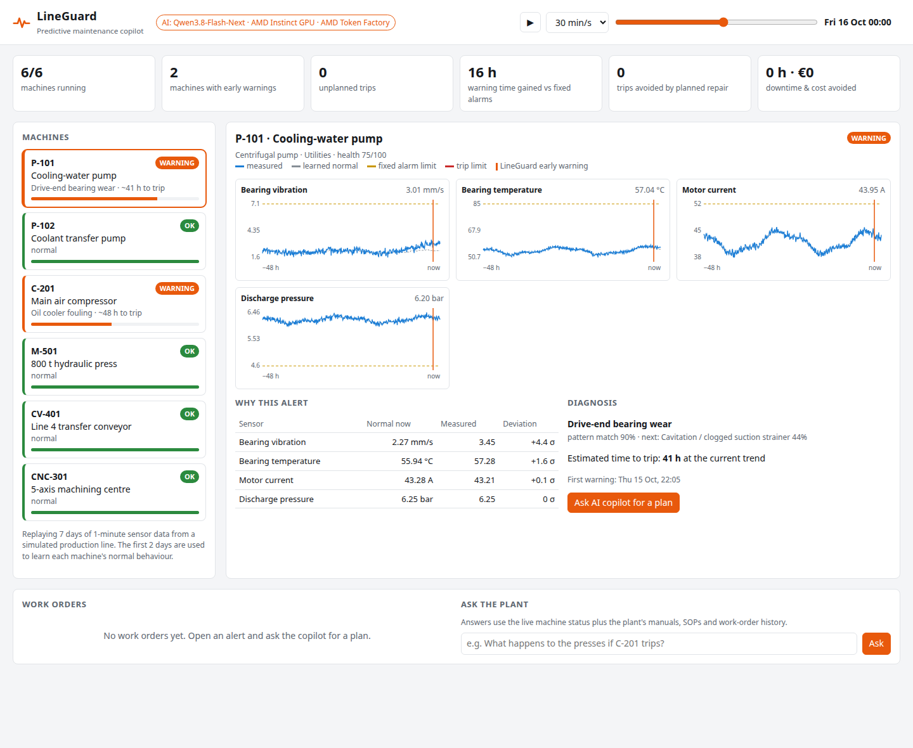
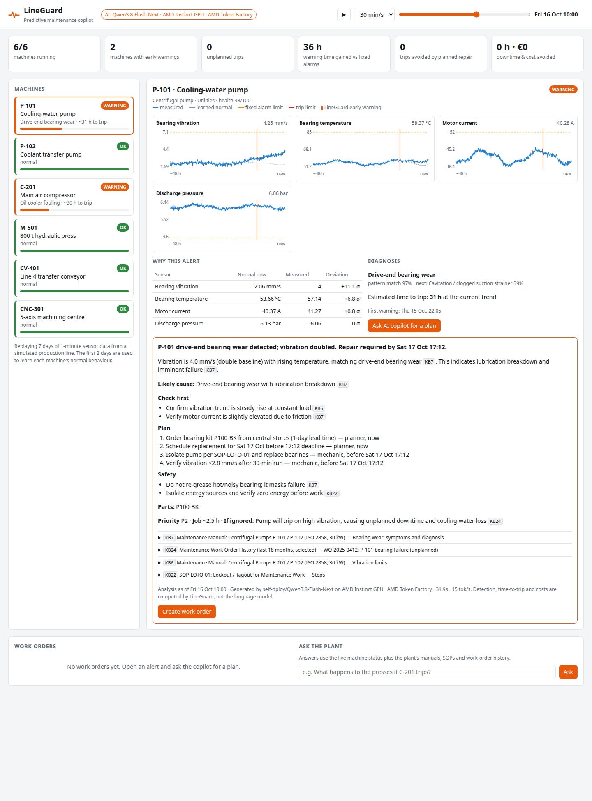
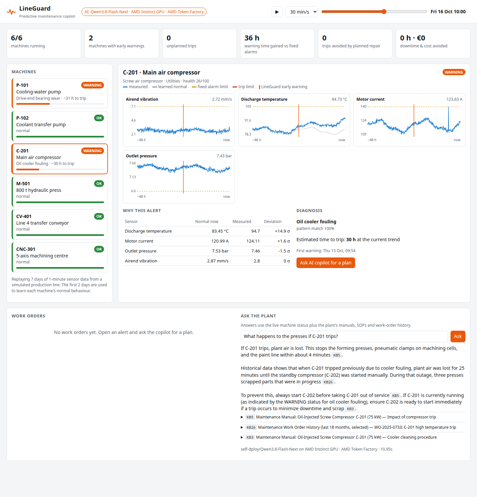
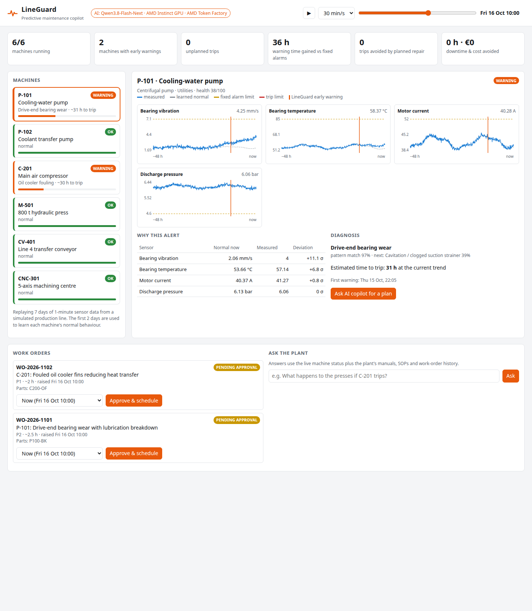
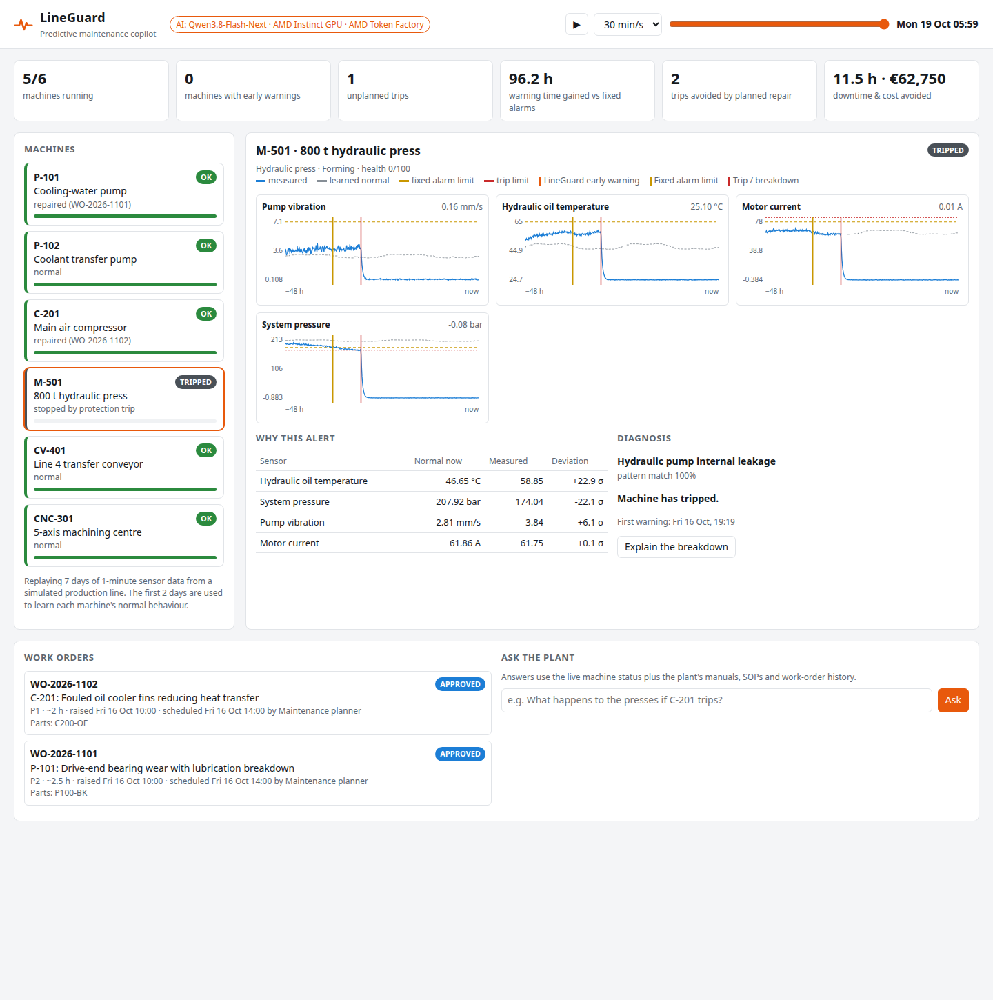

# LineGuard: predictive maintenance copilot on AMD

**AMD Developer Hackathon Act III, Track 1: Intelligent Industry**

Factories already collect vibration, temperature, current and pressure data. Their alarms
still fire only when a fixed limit is crossed, usually a few hours before a trip. By then
there is no time to order the part or plan the stop, so the line goes down during
production.

LineGuard watches the same sensors and spots machines drifting away from *their own*
normal behaviour **days earlier**. An AI copilot running on **AMD Instinct GPUs** then
explains the alert in plain language from the plant's own manuals and incident history,
and drafts a work order. A planner approves the work order with one click and books it into
a shift change. The repair happens in a planned stop instead of a breakdown.



**Users:** shift operators (what is wrong, how urgent, what do I check?) and maintenance
planners (which part, how long, when can we stop it?).

## Results

Measured on 50 random fault scenarios (149 developing faults) the detector never saw, with
`python -m scripts.evaluate --runs 50`:

| | Fixed alarm limits (today) | LineGuard |
|---|---|---|
| Faults warned before the trip | 149 / 149 (median 9.9 h ahead) | 149 / 149 (median **33.2 h** ahead) |
| False alerts on healthy machines | n/a | 0 per machine-month |
| Time-to-trip prediction, 1 day before the trip | n/a | median 0.96 × actual (10–90%: 0.84–1.04) |
| Downtime per fault | | **−3.1 h** |
| Cost per fault | | **−€18.7k** |

A warning only counts as "planned" if it arrives earlier than the part lead time in the
manual (pump bearing kit: 1 day; press pump: 1 day; compressor cooler clean: one shift).
Cost figures use the explicit, editable assumptions in [lineguard/impact.py](lineguard/impact.py).

> **Data note:** the plant data is simulated, with physically motivated degradation patterns
> (bearing wear shows vibration first and temperature later; cooler fouling shows rising
> discharge temperature and current), shift-load cycles, noise and sensor glitches. Simulated
> data gives exact ground truth for measuring lead time. Real plant data is noisier, so expect
> more false alerts and tune `WATCH_Z` / `PERSIST_MIN`.

## Screenshots

| | |
|---|---|
|  **1. Healthy plant**: every machine within its learned normal. |  **2. Early warning**: P-101 drifts; the fixed alarm is still far away. |
|  **3. AI plan** from Qwen3.8 on AMD: cause, checks, part, safety, all cited. |  **4. Ask the plant**: grounded answers from manuals and incident history. |
|  **5. Work orders** raised from the AI plan, approved into a shift-change slot. |  **6. End of week**: 2 trips avoided, €62,750 saved; the ignored press broke down. |

## How it works

```
sensors (1 min) ──► Detector (causal, explainable)          ──► Copilot on AMD GPU (LLM)          ──► Work order
                    • learns normal per hour of shift           • retrieves manual sections,          • operator / planner
                    • smoothed deviation + persistence            SOPs, past work orders (BM25)         approves a slot
                    • failure-mode signature match              • writes explanation, checks, plan,   • machine repaired in
                    • time-to-trip from the trend                 parts, safety, with citations         a planned stop
```

- **Detection is deterministic.** Each sensor is compared with the machine's learned normal for
  that hour of the shift ([lineguard/detector.py](lineguard/detector.py)). An alert opens when the
  smoothed deviation towards a protection limit stays above 3.5 σ for 15 minutes, which filters
  glitches. Hysteresis stops the alert from flickering. Fault type is matched by cosine
  similarity against known failure signatures. Time-to-trip is predicted by fitting a curve to the
  drift since it began and extending it to the trip limit (wear accelerates, so a straight line was
  too optimistic). The prediction is rough right after an alert opens and tightens as data arrives.
- **The language model only explains and plans.** It never computes the numbers. It receives
  the detector's evidence and the retrieved documents, and must cite them
  ([lineguard/copilot.py](lineguard/copilot.py)). The app removes citations that point to
  documents the model was not given, and always enforces lockout/tagout for hands-on work.
  If the AMD endpoint is down, a labelled template answer keeps the operator view working.
- **Closed loop.** An approved work order changes the replay: the machine is repaired at the
  booked slot instead of tripping, and the KPIs show the downtime and cost avoided.

## Where AMD is used

The copilot's language model (alert analysis and "Ask the plant" Q&A) runs on AMD Instinct
GPUs through an OpenAI-compatible endpoint. Either:

- **AMD Token Factory**, the hackathon API (no billing needed), or
- **your own vLLM server on an AMD Instinct MI300X** in AMD Developer Cloud (ROCm), e.g.
  `Qwen/Qwen3-30B-A3B-Instruct-2507`.

Measured on AMD Token Factory with `Qwen3.8-Flash-Next` (`python -m scripts.benchmark_llm`):
every response was a valid, cited plan; a full alert analysis takes ~18–30 s (~25 tokens/s,
~1.6k prompt tokens in, ~450 out). The app starts the analysis in the background as soon as an
alert opens, so in the demo the plan is usually ready when the operator clicks.

Setup steps for both are in [deploy/AMD.md](deploy/AMD.md). The UI header shows which model and
hardware answered, and every answer shows its latency and tokens/s. To get numbers for the
pitch, run `python -m scripts.benchmark_llm`.

## Run it

```bash
python3 -m venv .venv && . .venv/bin/activate
pip install -r requirements-dev.txt
cp .env.example .env            # fill in the AMD endpoint (see deploy/AMD.md)
set -a; source .env; set +a
uvicorn lineguard.api:app --port 8077
# open http://localhost:8077
```

Or with Docker:

```bash
docker build -t lineguard .
docker run -p 8077:8000 --env-file .env lineguard
```

Without an endpoint the app still runs in "template mode", which is useful for UI work but
is not the submission.

**Demo deep links:** `/?t=6000&asset=P-101&analyze=1` opens the first warning and runs the
copilot. `t` is minutes since Monday 06:00.

## Tests and evaluation

```bash
pytest -q                                   # detection, causality, diagnosis, LLM path, work-order loop
python -m scripts.evaluate --runs 50        # recall, false alerts, lead time, savings
python -m scripts.benchmark_llm --n 6       # latency + tokens/s on your AMD endpoint
```

## Project layout

| Path | What |
|---|---|
| [lineguard/simulator.py](lineguard/simulator.py) | Plant telemetry with injected degradation faults and ground truth |
| [lineguard/detector.py](lineguard/detector.py) | Early-warning detector, diagnosis, time-to-trip |
| [lineguard/knowledge.py](lineguard/knowledge.py) | BM25 search over manuals, SOPs and work-order history |
| [lineguard/llm.py](lineguard/llm.py) | OpenAI-compatible client for the AMD-hosted model |
| [lineguard/copilot.py](lineguard/copilot.py) | Grounded alert analysis, citation guard, safety enforcement |
| [lineguard/impact.py](lineguard/impact.py) | Downtime/cost model with explicit assumptions |
| [lineguard/api.py](lineguard/api.py) | FastAPI backend: replay clock, alerts, work orders |
| [static/index.html](static/index.html) | Operator UI (no build step) |
| [docs/slides/](docs/slides/) | Pitch deck (PDF + HTML) and speaker notes |
| [knowledge_base/](knowledge_base/) | Plant documents the copilot cites |
| [deploy/AMD.md](deploy/AMD.md) | Token Factory / MI300X + vLLM setup |

## License

MIT
